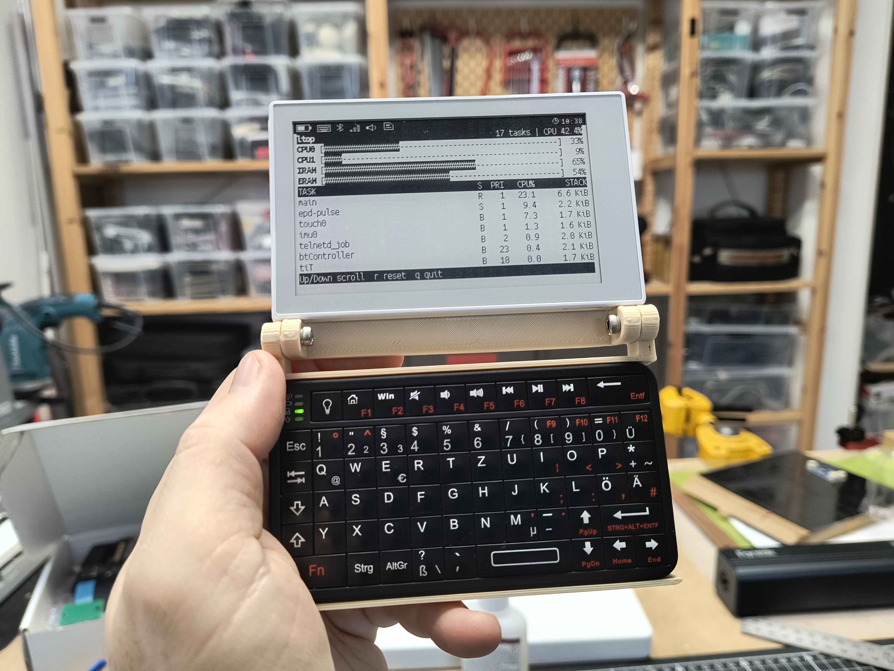
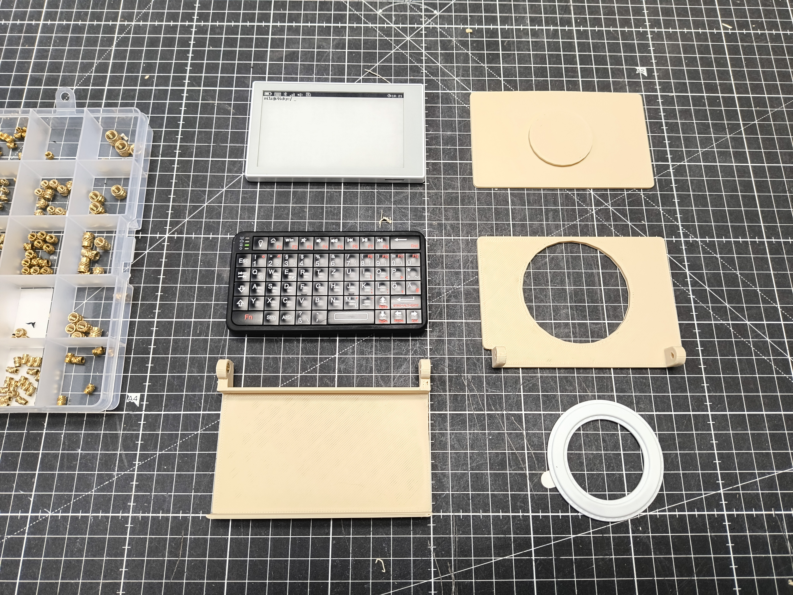
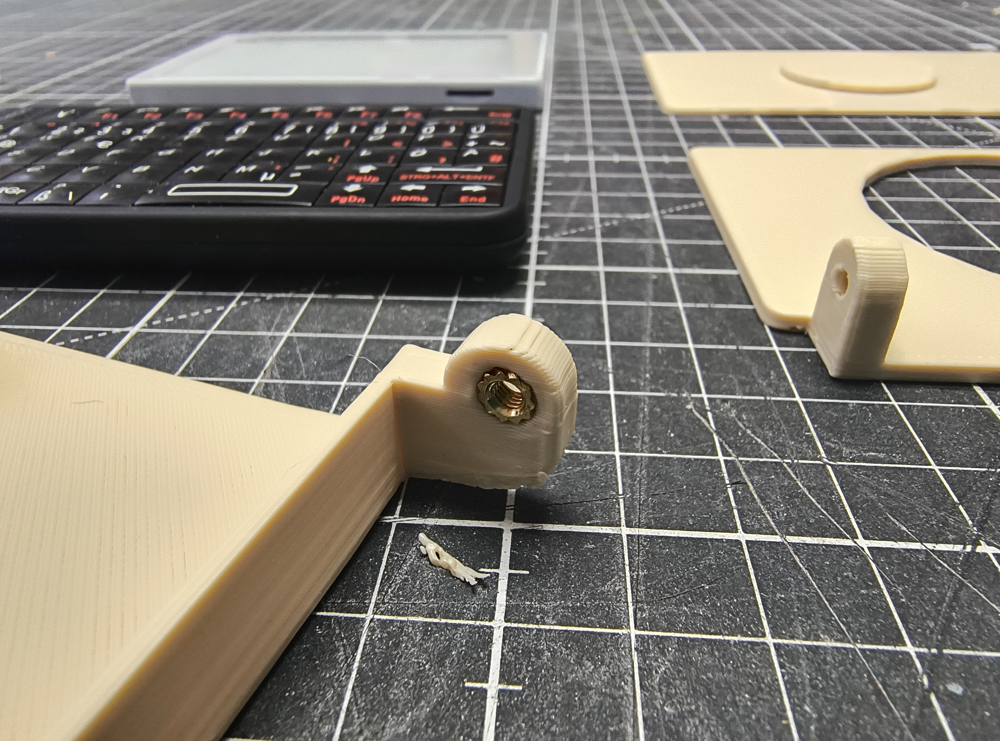
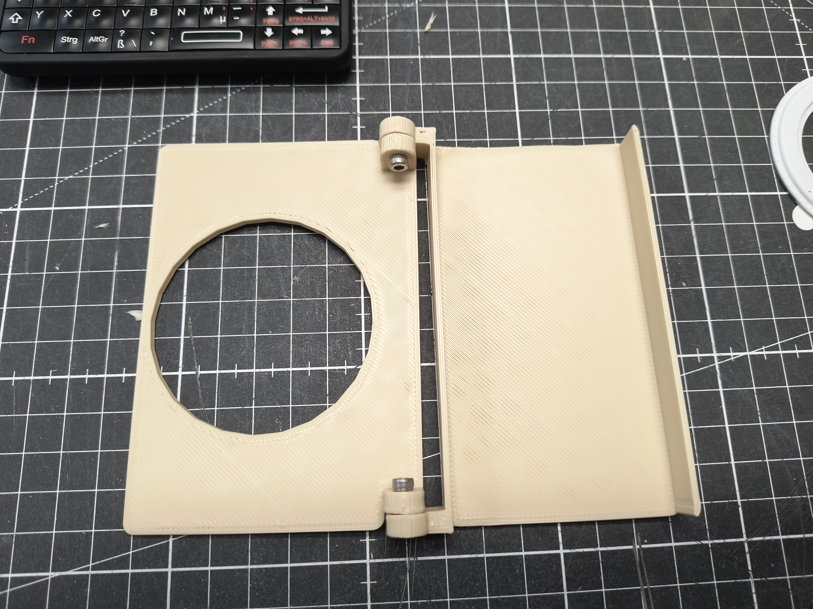
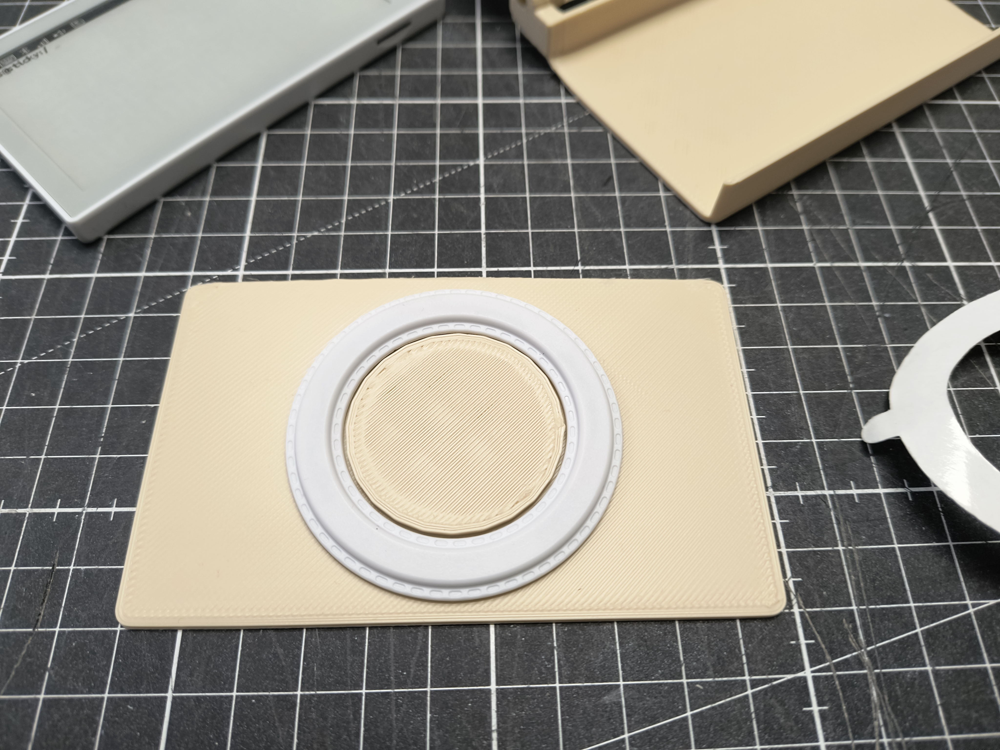
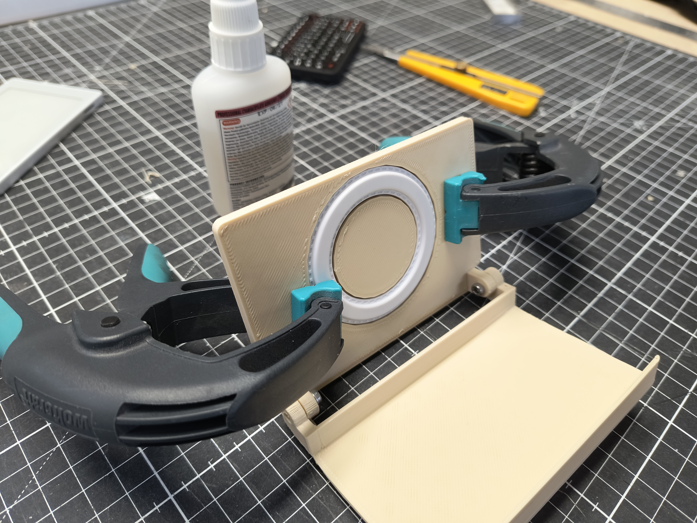
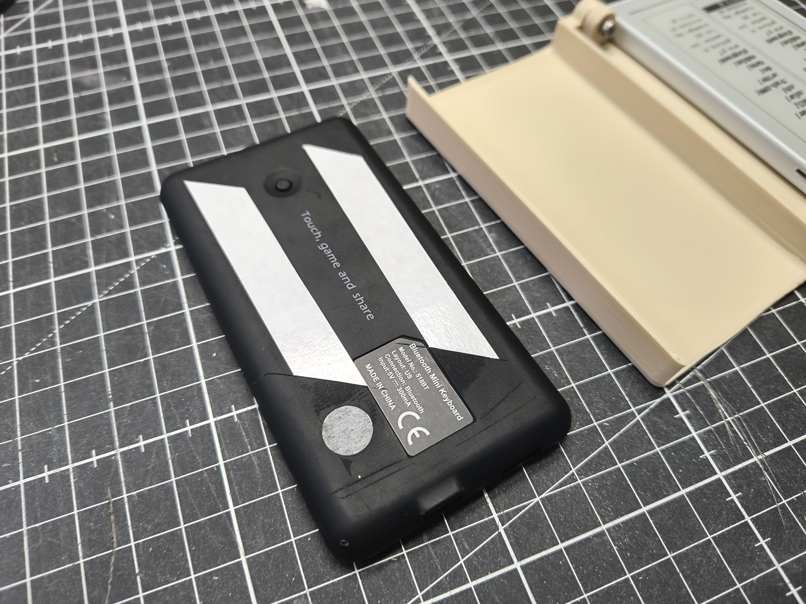
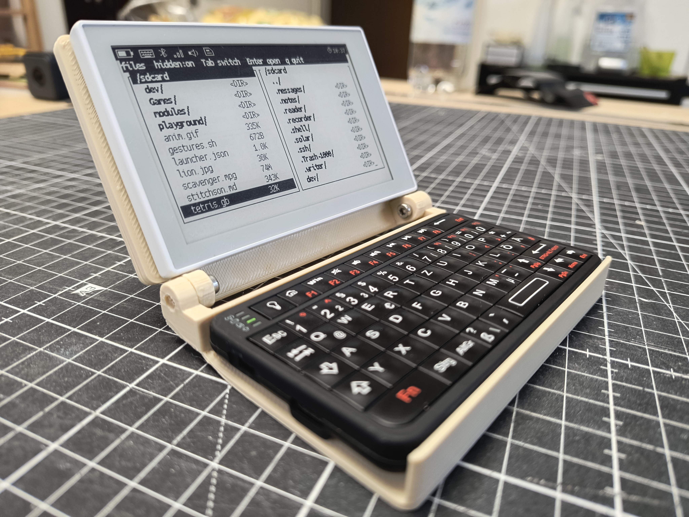
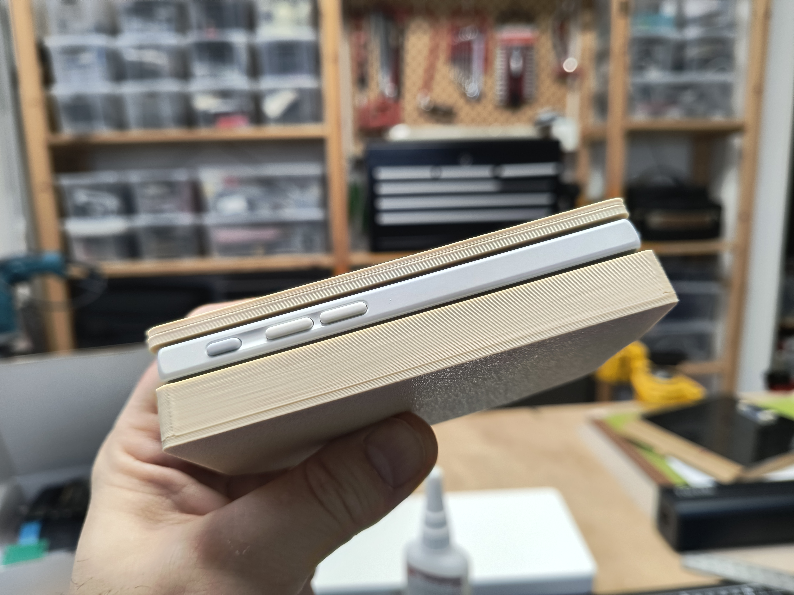

# StickyTerm enclosure

StickyTerm combines a **Seeed Studio reTerminal Sticky** e-paper touchscreen
with a **Rii 518BT Mini Bluetooth keyboard**. The keyboard sits in a folding
base, and a MagSafe mount lets the display rotate relative to the hinged top.
The Sticky stays in its original housing; no soldering is required.

## Parts

- 1 × Seeed Studio reTerminal Sticky, in its original housing
- 1 × Rii 518BT Mini Bluetooth keyboard
- 1 × MagSafe ring supplied with the reTerminal Sticky
- 2 × M3 threaded inserts, 3.5 mm outside diameter and 3 mm long
- 2 × M3 × 10 mm hinge screws
- adhesive suitable for bonding the printed parts
- thin double-sided mounting tape for the keyboard
- clamps to hold the top and cover together while the adhesive cures
- a data-capable USB-C cable for installing SolarOS and charging
- 1 × microSD card, optional

Print one of each part:

| Part | File | Purpose |
| --- | --- | --- |
| Bottom | [sticky_term_bottom.stl](../stl/sticky/sticky_term_bottom.stl) | Keyboard tray with hinge lugs |
| Top | [sticky_term_top.stl](../stl/sticky/sticky_term_top.stl) | Hinged panel with the circular MagSafe opening |
| Cover | [sticky_term_cover.stl](../stl/sticky/sticky_term_cover.stl) | Back plate with a circular boss for the MagSafe ring |

The editable [SketchUp model](../sketchup/sticky_term.skp) is included for
enclosure changes. Use the Sticky's supplied MagSafe ring for this build.

## Assembly

### 1. Print and check the parts

Print the bottom, top, and cover. Remove supports and clean the hinge holes,
the circular opening, and the cover's boss. Test the keyboard fit and the
MagSafe ring fit before attaching anything.

### 2. Install the hinge inserts

Fit one M3 insert, 3.5 mm outside diameter and 3 mm long, into each hinge lug
on the bottom part, as shown. Keep the inserts straight and flush so that the
top can move freely. If using heat-set inserts, install them before mounting
the electronics and let the plastic cool completely.

### 3. Assemble the folding hinge

Align the top's hinge lugs with the bottom's lugs. Insert an M3 × 10 mm screw
through each top lug and into the corresponding insert. Tighten gradually
until the hinge holds its position while still allowing the top to open and
close. Do not overtighten the screws or force the printed lugs apart.

### 4. Fit the MagSafe ring to the cover

Place the MagSafe ring supplied with the Sticky around the circular boss on
the cover, as shown. Check that it sits flat, with its magnetic mounting face
toward the display.

### 5. Glue the cover to the top

Fit the top over the cover so that the MagSafe ring sits in the circular
opening. Glue the printed cover to the back of the top, keeping the ring's
magnetic mounting face clear of adhesive. Clamp the printed panels evenly
while the adhesive cures, with the display and keyboard still removed. Follow
the adhesive's curing instructions before removing the clamps.

### 6. Mount the display and keyboard

After the adhesive has cured, attach the Sticky magnetically to the MagSafe
ring. Keep the buttons, USB-C port, and microSD slot accessible. Support the
housing while attaching it; do not press on the e-paper display.

Apply two strips of thin double-sided tape to the back of the keyboard, as
shown. Keep the pairing button and charging and power controls accessible.
Remove the tape backing, align the keyboard in the bottom tray, and press its
housing gently into place.

## Install SolarOS and pair the keyboard

Connect the Sticky with a data-capable USB-C cable and follow the
[SolarOS installation instructions](../README.md#install-solaros). Select
**Seeed Studio reTerminal Sticky** in the Web Flasher. Its SolarOS target and
PlatformIO environment are `seeed_reterminal_sticky`.

For a source build, follow the
[SolarOS quick start](https://solar-os.eu/quick-start.html#build-and-flash-from-source)
using that environment.

Once SolarOS has started:

1. Turn on the keyboard and press its rear pairing button.
2. Hold the Sticky's **Up** button for about two seconds to start BLE pairing.
3. Wait for the keyboard to connect, then type at the shell.

The Sticky's **AI/Power** button controls sleep and shutdown. **Up** is the
keyboard-pairing button. See the
[SolarOS Sticky board reference](https://solar-os.eu/docs/manual/boards.html#seeed-studio-reterminal-sticky)
for the board's controls and features.

## Finished build

Check that the display swivels freely, the hinge holds a useful viewing angle,
and both devices' controls and charging ports remain accessible. Align the
display with the base before folding it closed. Close it gently and check for
clearance between the display and keyboard.

